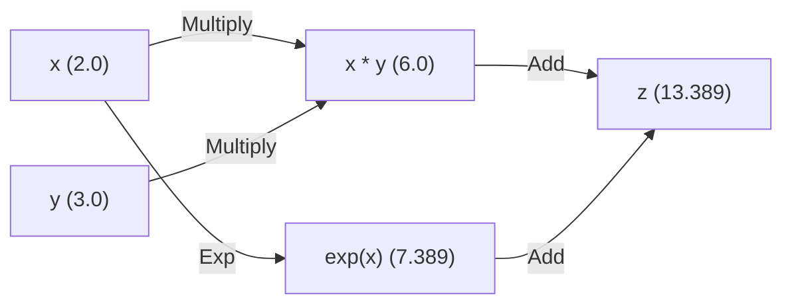

# Minigrad

[](https://www.python.org/downloads/)
[](https://github.com/astral-sh/ruff)
[](https://pytest.org/)
[](https://coverage.readthedocs.io/)
[](https://github.com/astral-sh/uv)
[](https://opensource.org/licenses/Apache-2.0)

A lightweight, fully type-annotated autograd engine designed for educational purposes. Minigrad demonstrates the mechanics of backpropagation in both scalar-level and tensor-level models.

Think of **Minigrad** as between Andrej Karpathy's [`micrograd`](https://github.com/karpathy/micrograd) and George Hotz's [`tinygrad`](https://github.com/tinygrad/tinygrad).

---

## Table of contents

- [Minigrad](#minigrad)
  - [Table of contents](#table-of-contents)
  - [Key features](#key-features)
  - [Project structure](#project-structure)
  - [Installation](#installation)
    - [Install for development](#install-for-development)
  - [Quick start and usage](#quick-start-and-usage)
    - [Scalar auto-differentiation](#scalar-auto-differentiation)
    - [Tensor auto-differentiation](#tensor-auto-differentiation)
    - [Training a neural network](#training-a-neural-network)
  - [Development and contributing](#development-and-contributing)
    - [Environment setup](#environment-setup)
    - [Running tests](#running-tests)
    - [Linting and formatting](#linting-and-formatting)
  - [License](#license)

---

## Key features

- **Scalar autodiff (`Scalar`)**: Full DAG construction and reverse-mode automatic differentiation supporting operations like addition, multiplication, subtraction, power, negation, exponentiation (`exp`), and hyperbolic tangent (`tanh`).
- **Tensor autodiff (`Tensor`)**: Multi-dimensional array operations backed by NumPy. Implements correct backpropagation through matrix multiplications (`@`), element-wise operations, powers, negation, and automatically sums out broadcasted dimensions via gradient unbroadcasting.
- **PyTorch-like neural network API**: Modular base class (`nn.Module`) for parameter tracking and zeroing gradients, coupled with a Stochastic Gradient Descent (`optim.SGD`) optimizer.
- **Strict developer tooling**: Fully typed with PEP 561 compliance (`py.typed` and `.pyi` stubs).

---

## Project structure

```text
minigrad/
├── notebooks/                   # Jupyter notebooks with interactive training examples
├── src/
│   └── minigrad/
│       ├── scalar/              # Scalar autograd engine
│       │   ├── engine.py        # Core Scalar class implementation
│       │   ├── engine.pyi       # Type stubs for Scalar
│       │   ├── nn.py            # Neural network Module base class
│       │   ├── ops.py           # Scalar math operations (Add, Mul, Tanh, etc.)
│       │   └── optim.py         # SGD Optimizer for Scalar parameters
│       ├── tensor/              # Tensor autograd engine
│       │   ├── engine.py        # Core Tensor class implementation
│       │   ├── engine.pyi       # Type stubs for Tensor
│       │   ├── ops.py           # Tensor math operations & unbroadcasting
│       │   └── _types.py        # Type aliases for nested lists & numpy arrays
│       └── py.typed             # Marker file indicating PEP 561 support
├── tests/                       # Unit, integration, and verification tests
├── pyproject.toml               # Project metadata, dependencies, and tool settings
└── uv.lock                      # Locked dependency graph for reproducible builds
```

---

## Installation

Minigrad uses [uv](https://github.com/astral-sh/uv) for lightning-fast package management and dependency resolution.

### Install for development

To clone the repository and install dependencies in an isolated virtual environment:

```bash
# Clone the repository
git clone git@github.com:firnlabs/minigrad.git
cd minigrad

# Synchronize virtual environment and dependencies
uv sync --all-groups
```

This creates a local `.venv` environment and installs all dev and notebook dependencies.

---

## Quick start and usage

### Scalar auto-differentiation

The scalar engine tracks operations on single values, maintaining a computation graph. Below is a simple graph representing:

$$z = x \cdot y + e^x$$



```python
from minigrad.scalar import Scalar
from minigrad.scalar import ops

x = Scalar(2.0, name="x", requires_grad=True)
y = Scalar(3.0, name="y", requires_grad=True)
z = x * y + ops.exp(x)
z.backward()

print(f"z: {z.data:.4f}")  # 13.3891
print(f"dx: {x.grad:.4f}")  # 10.3891 (y + e^x)
```

### Tensor auto-differentiation

The tensor engine works over multi-dimensional NumPy arrays and automatically sums out broadcasted dimensions during backward propagation.

```python
from minigrad.tensor import Tensor
from minigrad.tensor import ops

x = Tensor([[1.0, 2.0]], name="x", requires_grad=True)
w = Tensor([[2.0], [1.0]], name="w", requires_grad=True)
z = x @ w
z.backward()

print(f"z: {z.data}")  # [[4.0]]
print(f"dw:\n{w.grad}")  # [[1.0], [2.0]] (transposed x)
```

### Training a neural network

Minigrad provides a PyTorch-like modular design pattern with `nn.Module` and `optim.SGD` for model parameter optimization.

For a complete, interactive walkthrough of building and training a neural network using the scalar engine, see the [01_scalar_train_perceptron.ipynb](notebooks/01_scalar_train_perceptron.ipynb) notebook.

---

## Development and contributing

### Environment setup

Make sure you have `uv` installed (`pip install uv` or `brew install uv`).
Activate your virtual environment and install dependencies:

```bash
uv sync --all-groups
source .venv/bin/activate
```

### Running tests

The project features test coverage target configurations, checking integration, units, and verifying correctness. To run tests with pytest:

```bash
pytest
```

*Note: Configured options in `pyproject.toml` will automatically print missing lines and generate an HTML report inside `htmlcov/`.*

### Linting and formatting

Minigrad adheres to strict Google-style documentation standards and PEP8 coding guidelines. Use the following commands to check and format your code:

```bash
# Check code style & import ordering
ruff check

# Fix lints & format code automatically
ruff format

# Run docstring formatting checks
docformatter src/ tests/
pydoclint src/
```

Before committing, it is highly recommended to run pre-commit hooks:

```bash
pre-commit run --all-files
```

---

## License

This project is licensed under the [Apache License, Version 2.0](http://www.apache.org/licenses/LICENSE-2.0).
